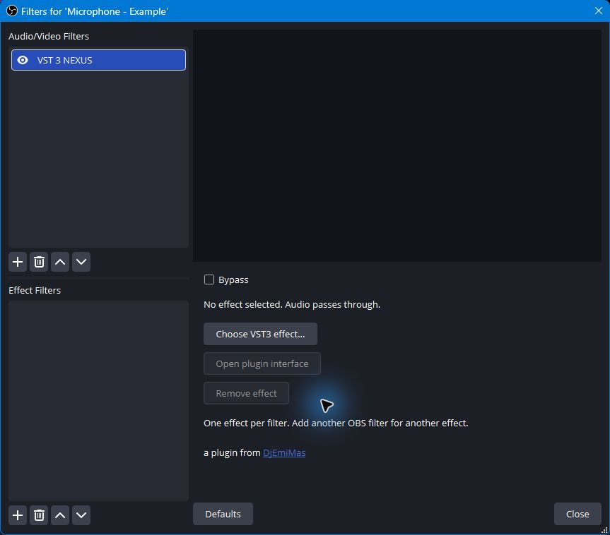
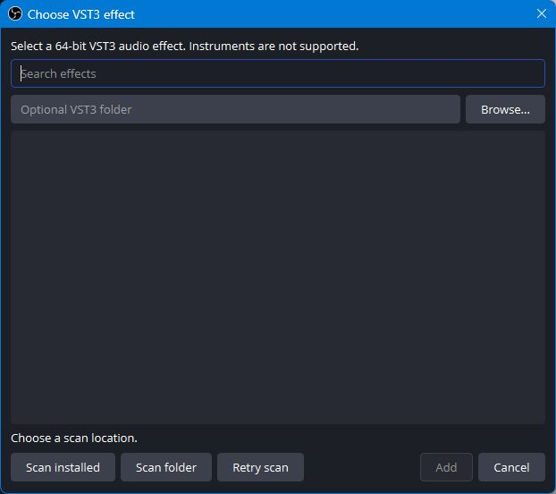
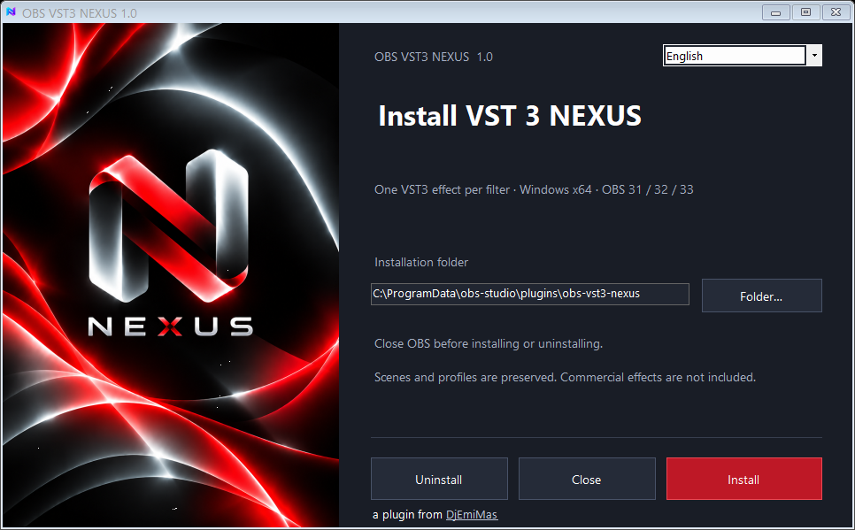

# OBS VST3 NEXUS 1.0

**Use your 64-bit VST3 audio effects directly in OBS Studio.**

A native Windows audio filter with one VST3 effect per instance and access to the effect's original interface. In OBS, look for **VST 3 NEXUS**.

**Windows x64 · OBS 31 / 32 / 33 · Audio effects only · Five languages**

## Download and install

Get the [official 1.0 release](https://github.com/Emidj/obs-vst3-nexus/releases/tag/v1.0).

1. Close OBS and run **OBS-VST3-NEXUS-1.0-Windows-x64-Setup.exe**.
2. Choose your language and click **Install**.
3. Open OBS, select an audio source, open **Filters**, and add **VST 3 NEXUS**.
4. Click **Choose VST3 effect…** and select one of your installed effects.
5. Click **Open plugin interface** to adjust its original controls.

The default plugin destination is `C:\ProgramData\obs-studio\plugins\obs-vst3-nexus`. An alternative destination does not automatically configure discovery in a portable OBS installation. The installer is unsigned.

**No VST3 effects are included. Install and license your effects separately.** OBS and Qt runtimes are not bundled either. The screenshots show the host itself without identifying or loading third-party effects.

## Features and controls

| Feature | How it works |
| --- | --- |
| One effect per filter | A simple host for a single 64-bit VST3 audio effect. Add multiple NEXUS filters in OBS to create a chain. |
| Choose VST3 effect… | Opens the effect browser with search and installed/custom-folder scanning. |
| Open plugin interface | Opens the selected effect's own editor. Its appearance and controls belong to its developer. |
| Bypass | Lets audio pass without the effect's processing. When an effect is selected, its name turns red while bypass is active. |
| Remove effect | Unloads the selected effect and refreshes the open controls. Removing an effect does not delete its files. |
| State persistence | Retains plugin state when closing its editor and captures state on source save when possible. |
| Five languages | English, Spanish, Italian, French and German; follows the OBS language, with English fallback. |

No VST2, instruments or MIDI. No rack window, Dock or Advanced mode in the released interface.

## Effect browser

- **Search effects:** filter discovered entries.
- **Scan installed:** search the standard VST3 locations.
- **Optional VST3 folder / Browse…:** choose a custom directory.
- **Scan folder:** scan that directory.
- **Retry scan:** repeat a scan when needed.
- **Add:** load the selected effect into this filter.

Scanning uses a helper process, caching and quarantine handling. This does **not** isolate audio processing: a native effect failure can still affect OBS.

## Typical workflow

For a microphone, add a NEXUS filter, choose your preferred VST3 processor, and adjust it in its original editor. To add a second processor, add another NEXUS filter beneath it in the OBS filter list. Use Bypass to compare the processed and unprocessed signal, then save your scene collection.

## Installation and removal

The installer supports installation, update and uninstall. Close OBS first. Reopen the same installer and choose **Uninstall** to remove the registered plugin files. Scenes, profiles, unrelated files and backups are preserved. Previous candidates retain the internal filter identifier `nexus_vst3`; custom filter names are preserved.

## Compatibility and limitations

- Windows x64 and 64-bit VST3 **audio effects**, for mono/stereo use. Instruments and MIDI are outside scope.
- Compatibility depends on the individual effect, its licensing system and the OBS/Qt environment; universal compatibility is not claimed.
- OBS capture timing is preserved. During effect reconfiguration, briefly aligned unprocessed audio and a 5 ms transition may be used. A timbre or level change can be audible.
- State capture can require active source audio. If capture fails, the previous saved state is kept.
- Plugin interfaces and their messages are controlled by the effect developer, independently of NEXUS's language.
- Long sessions and broader device, DPI, IME, hotkey and full project save/close coverage remain areas for further qualification.

See [compatibility scope](docs/VALIDATION.md), [development notes](docs/PLAN.md), [source review](docs/SOURCE-REVIEW.md) and [build instructions](docs/BUILDING.md).

## Source, licenses and references

Original project and installer source: **GPL-2.0-or-later**. Dependencies retain their original licenses. Required notices and pinned dependency source are included; no commercial effect binaries are redistributed.

- [LICENSE](LICENSE), [LICENSES.md](LICENSES.md) and [third-party notices](THIRD-PARTY-NOTICES.md).
- [Dependency versions and original sources](docs/REFERENCES.md).
- The release provides the installer, manual-install archive, full source archive and SHA-256 checksums.

*a plugin from [DjEmiMas](https://discord.gg/dhcqZPDYh)*
